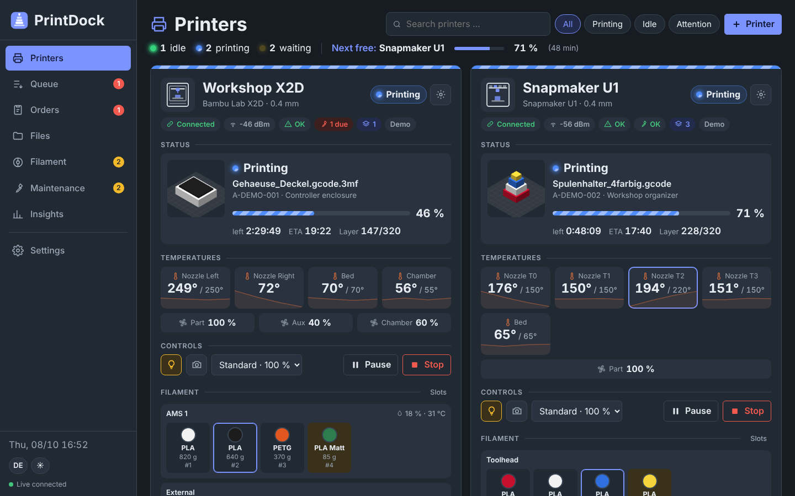
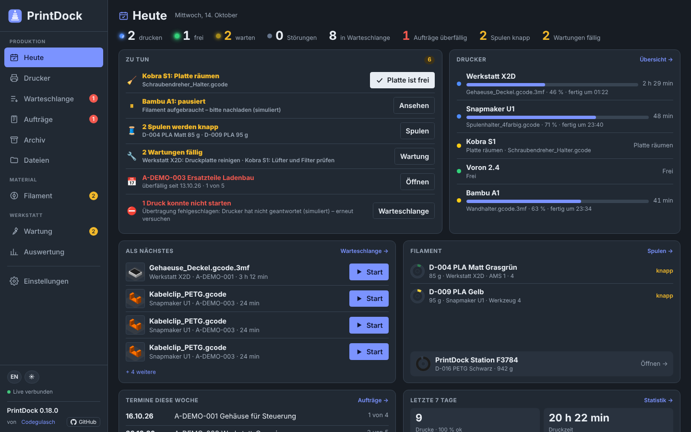
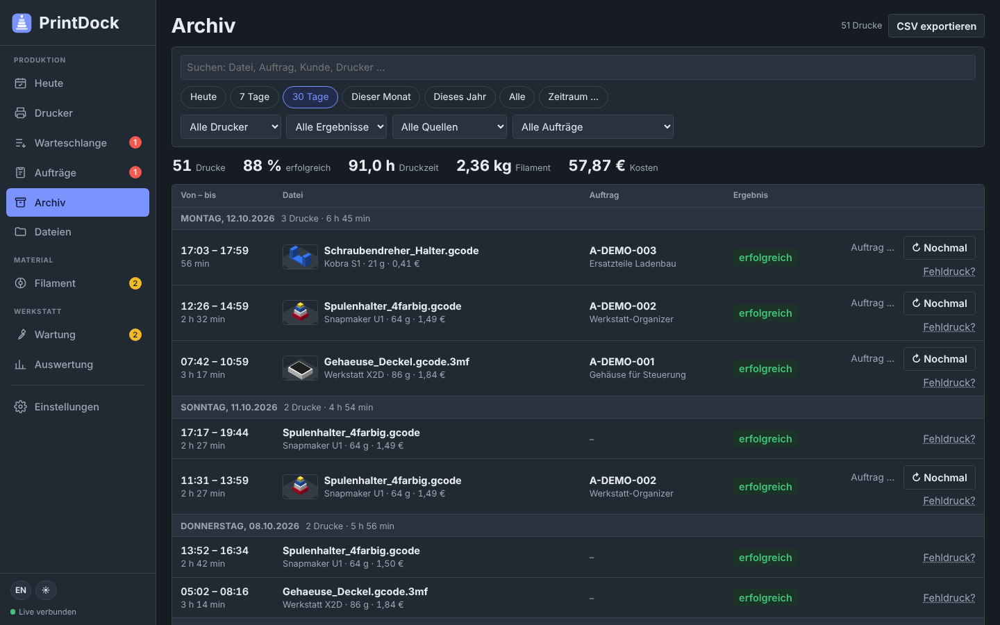
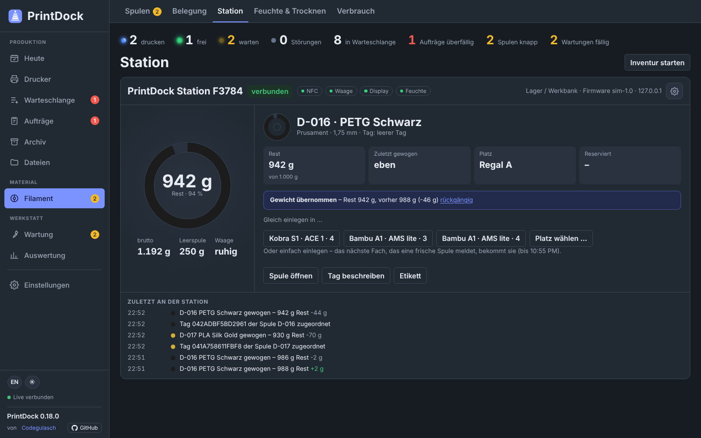
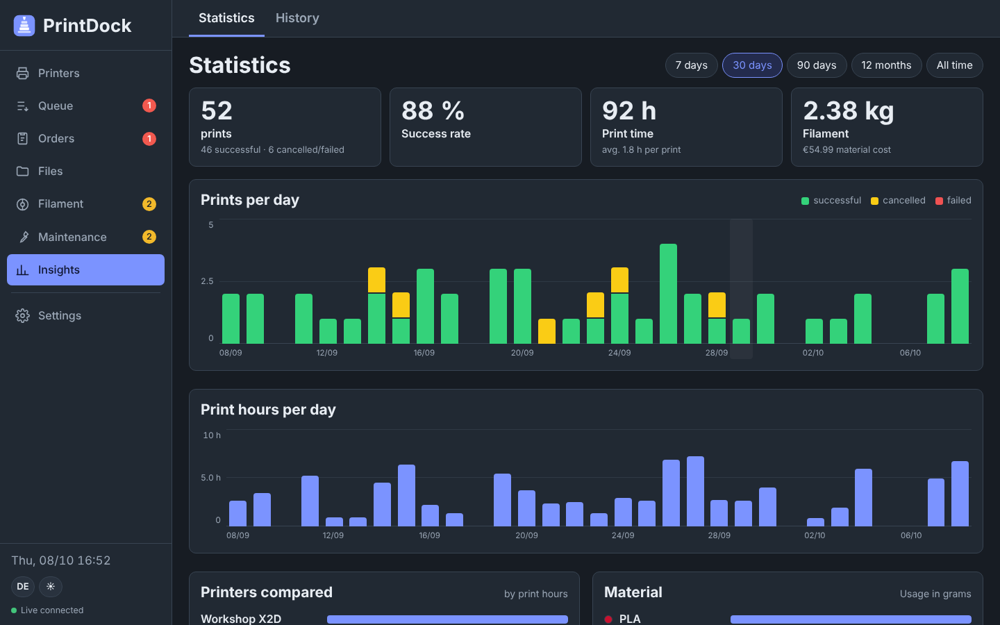
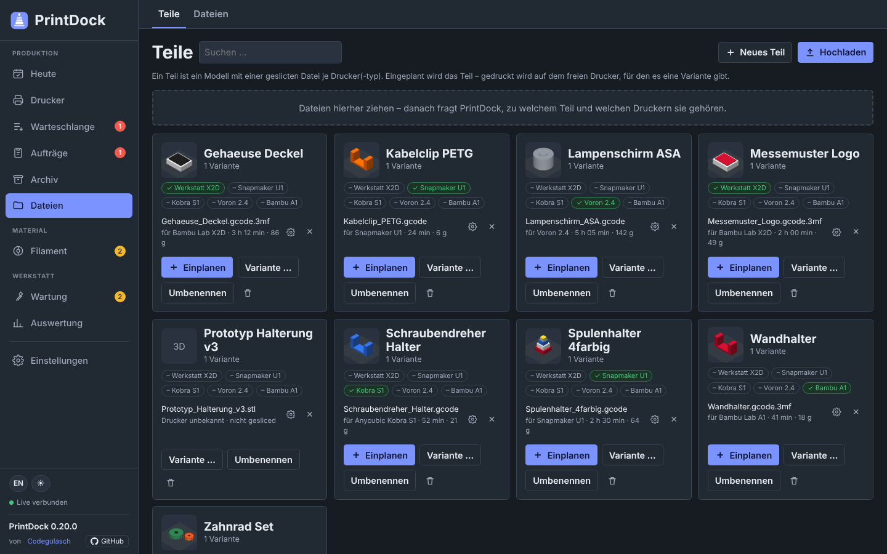
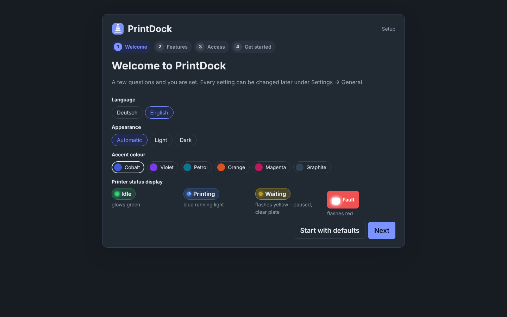
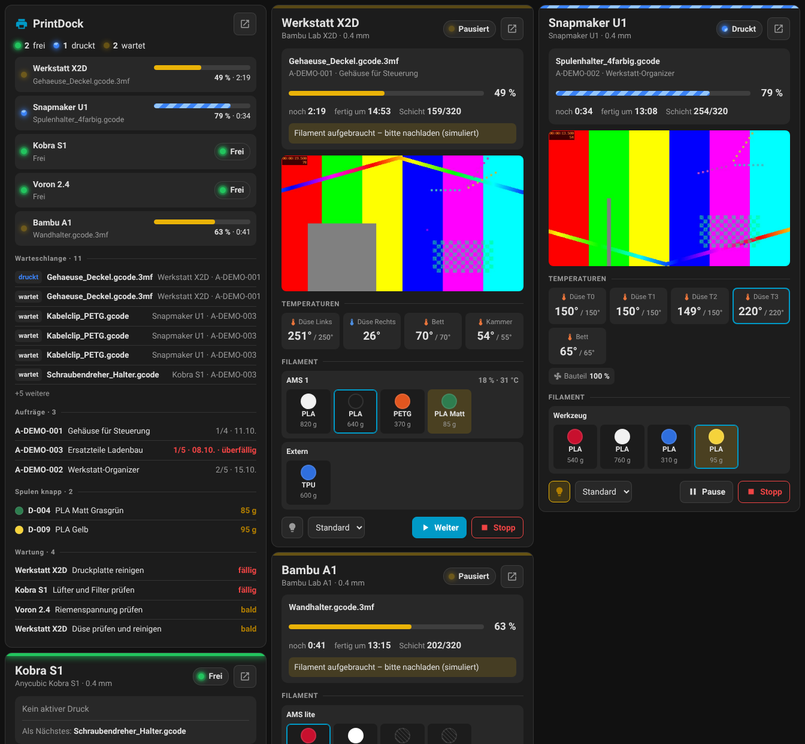

# PrintDock

*English · [Deutsch](README.de.md)*

**One dashboard for every 3D printer in the house – no matter the brand.**
Bambu Lab, Snapmaker U1, Anycubic (with ACE), Voron and any Klipper/Moonraker or OctoPrint printer. Inspired by [BamBuddy](https://github.com/maziggy/bambuddy), but not limited to Bambu Lab.



Fully local – no cloud, no account, no database. Runs as a **Home Assistant add-on**, in **Docker** (NAS, server, Raspberry Pi), as a **service on the Pi** or with **Node.js on Windows, macOS and Linux** – with the same features everywhere.

> **Public beta** – PrintDock is used daily in a real workshop, but it is still under development: the interface and workflows may change, and not every printer and firmware combination has been tested. Please keep backups switched on (*Settings → System → Backup*, runs daily by itself) and report bugs or wishes via the [issues](https://github.com/Codegulasch/printdock/issues/new/choose) – ideally with version and platform check. Thanks for testing!

**Contents:** [Features](#what-printdock-does) · [Installation](#installation) · [Supported printers](#supported-printers) · [How a print flows](#how-a-print-flows-through-printdock) · [Archive](#archive) · [Filament](#filament) · [Home Assistant](#home-assistant) · [Slicer](#slicer) · [Reslicing](#reslicing) · [Remote access](#remote-access-users-and-security) · [Updates and backup](#updates-backup-platforms) · [Report a bug](#report-bugs-and-contribute)

## What PrintDock does

### Printers at a glance

- **Live status** of all printers: progress, time left, ETA, layer, temperatures with history, fans, light, speed; pause, resume, cancel
- **Status lights** on every card: idle = green, printing = blue running light, waiting = flashing yellow, fault = flashing red
- **Camera** for every printer (incl. Bambu RTSP and JPEG streams) with full-screen view and snapshot; optional **photo after the first layer**
- **Start page "Today"**: what needs doing (clear plates, failed prints, stuck entries, labels, humidity, shopping, maintenance, due dates), what is printing and what comes next
- **Notifications** with camera image via ntfy, Telegram, Discord, Gotify or webhook
- **Archive** of all prints with start and end, grouped by day, with search, filters and CSV export – **including prints sent straight from the slicer or started on the touchscreen**
- **Areas** for print farms and different rooms: assign printers, overview grouped and filterable by area, send queue entries and orders to an area
- **Statistics**: prints, success rate, print hours, material, costs, failed prints and scrap, printers compared

### Production

- **Parts with variants**: one model, one sliced file per printer – schedule the part, it prints on the free printer with a matching variant (across brands)
- **File library** for G-code and 3MF with detected print time, filament, printer profile and preview; on upload PrintDock asks which part and which printers the file belongs to
- **Reslicing** (optional): if a part lacks the variant for a printer, a small helper on your PC slices it with OrcaSlicer – using the settings PrintDock learned per printer from your 3MF uploads
- **Slicer integration**: send from OrcaSlicer, PrusaSlicer & co., from Bambu Studio via the inbox folder; open files in your slicer
- **Print mode per order and entry**: *series print (automatic)*, *series print (manual)* or *single print*
- **Print queue** with *"plate is clear"* confirmation and **automatic printer choice** by profile and loaded filament
- **Orders** with items (file × quantity), due date, priority, **several parts per plate**, estimate/quote and actual costs
- **Series printing**: print finished → the next part of the order is queued on that printer → starts by itself after "plate clear"
- **Start windows** per printer and waiting for cheap power or PV surplus
- **"Does not start because …"**: after "plate clear" PrintDock says right away whether it starts – or why not, with a button to fix it
- **Failed prints** requeued with one click, reasons, scrap in costs and statistics
- **Stuck entries** ("printing" although the printer finished long ago) are detected and cleaned up
- **Post-processing** steps (remove supports → check → packed → shipped)
- **Colour mapping at start**: Bambu AMS mapping, tools renumbered in the G-code on Klipper/OctoPrint
- **Maintenance planner** by operating hours, prints or days

### Filament

- **Spool inventory** with AMS, ACE and toolhead slots, automatic deduction after every print, costs and low-stock warnings
- **Reservation** for all open prints, **shopping list** with shop link, "ordered" and "arrived"
- **Humidity**: monitoring of AMS/ACE, Home Assistant sensors and stations; **humidity check before starting** ("dry first, then start automatically"); **drying at the push of a button**
- **PrintDock Station** (ESP32 with NFC, scale, humidity sensor – DIY, printable case still in the works) as a **workbench**: place a spool → recognised, weighed, loaded into a free slot with one button; create or assign new tags, history, notice from anywhere and **stocktake**
- **Read and write RFID/NFC tags with the phone** (Chrome on Android); spool labels with QR code
- **Spoolman** optional – import inventory and report usage back

### Customers

- **Status link per order**: progress, due date, expected finish, post-processing and photos of finished parts – no costs, no login
- **Your own status server** (`relay/`): customer links work from anywhere without opening the home network – as **PHP for regular web hosting** or Node.js/Docker
- **Labels** for finished parts with a QR code to the status link
- **Print portal**: requests, quotes and settings of your own portal right in PrintDock, fetch confirmed orders, report progress back, and **workshop live** – a public "What's printing?" page with printer nicknames

### Home Assistant

- Switch printers via **smart plugs**, **auto-off** after cool-down, **electricity per print**
- Every printer as an **MQTT device**, two **dashboard cards**, **automation blueprints**
- **Emergency stop**: smoke detector or temperature sensor switches the printers off
- Runs as an **add-on** with sidebar entry, automatic connection and inclusion in HA backups

### Access and operation

- **Remote access** via Tailscale or Cloudflare Tunnel – switched on right in PrintDock
- **Login protection** always or only from outside; **several users** (admin, operator) with a **log**
- **Updates** with one click (add-on, Docker, Pi, PC), **daily backup**, moving via backup zip
- **Platform check** shows what works on the current installation
- **Setup levels** Hobby, Maker, Workshop – PrintDock shows only what you need; switched-off features are listed under **"Discover more"**
- **Setup wizard**, **every feature can be switched off**, **arrange the menu, "Today" and printer cards** and choose the start page
- **German and English**, accent colour, your own themes (logo, colours, fonts), light and dark mode, works on phones
- **Demo data** with one click: 5 simulated printers, files, spools, orders and 30 days of history – simulation in real time or time-lapse, optional automatic plate clearing, never touches real stock

| Today | Archive |
|---|---|
|  |  |
| **Station** | **Statistics** |
|  |  |
| **Parts** | **Setup wizard** |
|  |  |

**New here?** → [Getting started](docs/getting-started.md): from first start to first print in ten minutes.

## Installation

All options in detail: [docs/installation.md](docs/installation.md). In short:

**Home Assistant (recommended if you have it):** *Settings → Add-ons → Add-on store → ⋮ → Repositories* → add `https://github.com/Codegulasch/printdock` → install **PrintDock**, start it and enable *Show in sidebar*.

**Docker** (NAS, Raspberry Pi, server):

```bash
mkdir printdock && cd printdock
curl -O https://raw.githubusercontent.com/Codegulasch/printdock/main/docker-compose.yml
docker compose up -d
```

**Raspberry Pi / Debian without Docker** (as a service):

```bash
curl -fsSL https://raw.githubusercontent.com/Codegulasch/printdock/main/scripts/install.sh | sudo bash
```

**Windows, macOS, Linux PC:** install [Node.js](https://nodejs.org) (LTS), [download PrintDock as a zip](https://github.com/Codegulasch/printdock/archive/refs/heads/main.zip) and unpack it. On Windows double-click `scripts\start-windows.cmd` – it starts PrintDock and restarts it by itself after updates or a restore. On macOS/Linux run `npm install && npm start` in the folder.

Then open `http://<ip>:3080` (as add-on: via the sidebar). The setup wizard asks for language, look, setup level and access and can load demo data. Everything can be changed later under **Settings → General**. **Settings → System → Platform check** shows what works on this installation (restart, update, ffmpeg, remote access, Home Assistant, inbox, backup, time zone).

## Supported printers

| Connection | Printers | Requirements |
|---|---|---|
| **Klipper / Moonraker** | Snapmaker U1, Anycubic Kobra 3 / S1 (with [Rinkhals](https://github.com/rinkhals-community/Rinkhals)), Voron, rooted Creality K1/K2, any Klipper printer | Moonraker reachable (port 7125) |
| **Anycubic (LAN mode)** | Kobra S1 / S1 Max, Kobra 3 / 3 Max, Kobra 2 Pro with stock firmware, incl. ACE Pro | LAN mode enabled on the printer; IP address |
| **Bambu Lab (LAN)** | X1, P1, A1, H2D, X2D | LAN mode (newer firmware: developer mode); IP, serial number, access code |
| **OctoPrint** | Any Marlin printer with OctoPrint | API key |
| **Demo** | – | Simulated printer to try things out |

- **Snapmaker U1** – Moonraker is enabled out of the box; add it as *Klipper / Moonraker*.
- **Anycubic Kobra S1 / Kobra 3** – with the stock firmware, enable *LAN mode* on the printer and add it as *Anycubic (LAN mode)*: status, pause/resume/cancel, light, camera, ACE slots (material and colour) and ACE drying. To start prints, install Rinkhals and also enter its Moonraker port (usually 7125): status, ACE and drying stay on LAN mode, prints go through Moonraker. Without Rinkhals, start prints on the printer or from the slicer. The LAN protocol follows [anycubic-lan](https://github.com/Nino6689/anycubic-lan).
- **Bambu Lab** – enable LAN mode; the access code is in the network menu. Newer firmware only accepts control commands from third-party software in developer mode. Starting prints and the second nozzle of H2D/X2D are **experimental** – feedback from real devices is welcome.

## Status lights

| Light | Meaning |
|---|---|
| 🟢 green, glowing | **Idle** – ready for the next print |
| 🔵 blue, running | **Printing** (also preparing / sending a file) |
| 🟡 yellow, flashing | **Waiting** – paused, or the plate needs clearing |
| 🔴 red, flashing | **Fault** |
| ⚪ grey | Unreachable |

The colours are fixed and independent of the accent colour; every light also shows the state as text.

## Interface

Sidebar with all areas and counters for open items; at the bottom language (DE/EN), light/dark and logout. **Order, hidden items and start page** of the menu are set under *Settings → General → Menu* – for all devices or only this one (e.g. the phone). Features switched off under *Settings → General → Features* disappear from the menu and the cards; their data is kept.

**Setup levels:** in the setup wizard and under *Settings → General* you pick a starting point – **Hobby**, **Maker** (adds queue with auto start, statistics, maintenance) or **Workshop** (adds orders with costing, customer links, post-processing, areas). Every feature can still be switched individually; what is off is listed under **"Discover more"** with one sentence on what it does.

**Arrange:** on *Today* and *Printers*, **Arrange** lets you drag (or move with arrows, also on phones) boxes and printer cards and hide boxes on *Today* – for all devices or only this one.

**Parts with variants:** under *Files → Parts* a part is a model with one sliced file per printer (type). Queue and orders schedule the part; it starts on the free printer that has a variant – an order "20 × cable clip" spreads over several printers of different brands. On upload PrintDock asks which part the file belongs to and for which printers (preselected by the printer model in the file), optionally scheduling it right away. Files from the slicer and the inbox are assigned automatically: same name and printer = new version, same name and other printer = another variant.

Every printer card shows header (model image, name, nozzle, plug button), badges (connection, Wi-Fi, Bambu HMS, humidity, maintenance, planned prints), status (preview, file, order, progress, time left, finish time, layer – or "clear plate" / "ready", then the next queued print or "does not start: …" with the reason), temperatures with history, fans, controls (light, camera, speed, pause/resume/stop) and filament (AMS/ACE units with humidity, temperature and dryer, every slot with colour, material and remaining amount).

## How a print flows through PrintDock

```
Slicer ──"Send to printer"──┐
Upload (Files) ─────────────┴─> File library
                                   │
Order (file × quantity) ───────────┤ "Schedule"
                                   ▼
                     Queue ──Start (confirm plate clear) / automatic──> printing
                       ▲                                                   │
          "Plate is clear" confirmed  <──────── print finished ────────────┘
                                         (history, order progress, filament deducted,
                                          maintenance hours counted)
```

- **Plate clear:** after every print the card shows "clear plate" (flashing yellow). Only after **Plate is clear** does the next print start. Manual starts from the queue or an order also require ticking **"build plate is clear"** (can be switched off).
- **Print mode** (on the order and on every entry; default under *Settings → Printers & filament → Print start*):
  - **Series print (automatic)** – all prints are queued, after "plate clear" the next one starts by itself.
  - **Series print (manual)** – all prints are queued, the next one waits with **Start** on the printer card and never starts by itself.
  - **Single print** – only one print is queued at a time and started by hand; *Print* on an order prints the next single part.
- **Does not start?** After "plate clear" PrintDock tries to start immediately and shows on the card, on *Today* and in a message "Starting: X" or "Does not start because …" – print mode manual or single, entry still stuck on "printing", last start failed, filament too humid, outside the start window, profile or filament does not match – each with the button that fixes it. Failed starts are retried after 2 minutes (up to 3 times).
- **Assignment:** an entry belongs to a fixed printer or to "matching printer". The latter goes to the free printer whose profile the file was sliced for and that has the matching filament loaded (closest colour wins). Files sliced for another profile are never started.
- **Order:** requeued failed prints first, then order priority (urgent before normal), due date and manual order (▲▼).
- **Colours at start:** PrintDock suggests which slot or tool prints which filament of the slice by material and colour – every row can be changed. Bambu gets it as AMS mapping; on Klipper and OctoPrint the tools are renumbered in the G-code (e.g. T0 → T2).
- **File format:** Klipper and OctoPrint need `.gcode`, Bambu a sliced `.gcode.3mf`. PrintDock checks this before starting. Starting on Bambu (FTPS + MQTT, LAN/developer mode) is experimental.
- **Transfer:** as soon as the printer reports the print, the start counts as done – even if the answer to the upload never arrives (e.g. Snapmaker U1). If PrintDock restarts during a transfer, it matches the entry against the history instead of printing the file twice.

### Series printing and start windows

- **Series print (automatic):** when a print is finished, PrintDock queues the next open part – of the same order first, otherwise of another automatic order by priority and due date – on this printer and starts it as soon as the plate is confirmed clear. Only files with matching profile, filament and humidity.
- **Start window** (in the printer settings): automatic starts only e.g. between 07:00 and 22:00 (outside only short prints). Long prints can wait for cheap power – any Home Assistant entity: price below a value, export above a value or a PV-surplus switch. Manual starts always work.

### Parts per plate, post-processing, failed prints

- **Parts per print** per order item: 20 parts with 4 per print plans 5 prints; progress, costs, time left and reservation count accordingly.
- **Post-processing** (option): steps such as remove supports → check → packed → shipped with counters per order, a summary on *Today* and progress in the customer status link.
- **Failed prints:** cancelled or failed prints appear on *Today* with **Requeue** (same file and colour mapping, top of the queue) or *Fine as is*. A finished but unusable part can be marked as **failed** in the history – it no longer counts as done and its material is booked as scrap. Reasons show up in the statistics per printer.
- **Stuck entries:** running prints survive a restart of PrintDock (e.g. during an update). If an entry still shows "printing" while the printer has been ready for 3 minutes, PrintDock closes it as finished at 95 % or more, otherwise it asks on *Today* and in the queue: *Was finished* / *Cancelled*. Order, history and filament are updated. Every running entry also has *Stuck?*.

### Costs, electricity and photos

Every print in the history shows its costs – filament by spool price, electricity (from a metering plug in Home Assistant, or estimated), optionally machine hours and markup. Orders show an estimate from the sliced files, the actual costs and scrap; *Print estimate / quote* creates a printable page. At the end of a print PrintDock saves a camera image of the finished part, optionally also after the first layer. Finished orders can be archived.

## Archive

*Archive* in the menu lists every finished print with **start and end** (from–to), duration, printer, file, photo, filament, costs, order and result – grouped by day, with totals (prints, success rate, print time, filament, costs).

- **Search** across file, order, customer and printer; **filters** for period (today, 7/30 days, month, year, custom), printer, result (incl. failed print), source (from PrintDock or printer/slicer) and order (with, without, not yet assigned, a specific one); **CSV export** of the filtered list
- **Print again** schedules the same file (same plate) again
- up to 20,000 prints are kept

**Prints that did not come from PrintDock** – sent straight from the slicer to the printer or started on the touchscreen – end up in the archive too:

- PrintDock notices them in the printer status and **fetches the file from the printer** into the library (*taken over from the printer*): Klipper/Snapmaker U1 via Moonraker, Bambu via FTPS from the SD card (incl. the printed plate), OctoPrint via its download URL, Anycubic only with Rinkhals. Identical files are recognised by content and stored once. That gives preview, grams per colour, filament deduction (also on Bambu), costs and *Print again*. For multi-colour prints the grams go to the tools or – on Bambu – to the used slots by material and colour.
- **Assign an order:** if the print clearly matches one open order item (same file or same name), it counts there automatically. Otherwise it shows up on *Today* and in the archive with *Assign order …* (suggestions, any order or *no order*). Assigned prints count as finished parts – with costs, photo, label and customer status link; a waiting queue entry of that item counts as done.
- While such a print runs, the queue says "waiting until X is done" and *Today* says the printer is busy with a print that did not come from PrintDock.
- **Resumed after a power cut:** if the printer resumes the same print at the same point shortly after it stopped, PrintDock counts it as one print – no double deduction, no failed-print question.
- **Re-sliced version:** when a file with the same name but different content is uploaded and an open order still uses the old one, *Today* offers to switch that order to the new version.
- Settings under *Settings → Printers & filament → Archive*: take over files on/off, maximum size, delete taken-over files without an order after X days (default 90, the archive entry stays), assign automatically on/off.

## Customer links

Every order can get a **status link** with QR code: progress, due date, expected finish, post-processing and photos of finished parts – **no costs**, no login, not guessable. Plus **labels** for finished parts (order, part x of y, customer, date, QR code), printed together from *Today* or the order.

When PrintDock runs at home, such a link points to an address like `192.168.x.x` that customers cannot reach. That is what the **status server** in [`relay/`](relay/README.md) is for: it runs on your own server or web hosting, and PrintDock **pushes** status data and photos to it on every change. Connections only go out from PrintDock; the home network stays closed.

- **PHP version** (`relay/php`) for regular web hosting: upload via FTP, put a key into `config.php`, done – also without URL rewriting and on hosts that only allow GET/POST
- **Node.js/Docker version** (`relay/server.js`) for your own server
- several PrintDock installations with their own keys, company name and link in the footer, pages expire after the order is done (default 30 days), turning a link off deletes it on the server too

Set it up under *Settings → Remote access → Customer links*; guide in [relay/README.md](relay/README.md).

### Print portal and workshop live

If you take orders through your own **print portal** on regular web hosting (customers upload STL/3MF, get a price estimate and confirm a quote), connect it under *Settings → Remote access → Print portal*:

- **Fetch orders:** confirmed (optionally only paid) orders come into PrintDock automatically – model files into the library, an order with items, material and colours as notes, plus a status link
- **Status back:** *printing* as soon as a part runs, *shipped* when the post-processing step "Versendet" is done, *closed* with the order – the customer sees it in the portal and by email if wanted
- **Customer links via the portal:** the portal is also the status server (same interface as `relay/`), so customers see progress and photos on their order page
- **Workshop live:** every minute a snapshot of the printers for a public "What's printing?" page – nickname and colour per printer, status, progress, material and end time. Customer orders only appear as "Customer order"

All connections go out from PrintDock; the home network stays closed.

**Run the portal entirely from PrintDock** (menu item *Print portal*, appears once a portal with the full [print portal interface](docs/portal-api.md) is connected):

- **Requests:** every request with status, customer, parts and price; per request a **3D preview** of each model file (STL and 3MF, rotate and zoom), download, the customer's message and history
- **Edit:** status, quoted price, shipping, quote note, message to the customer (optionally by email with the portal's template), tracking number, internal note, *paid*, delete, *Take over into PrintDock* right away
- **Price suggestion:** weight and print time from the portal × your cost rates (material, power, machine hour, markup) plus the portal's base fee, colour surcharge and minimum order value – one click to use it as the quote
- **Nothing gets missed:** new requests, accepted or declined quotes and customer messages stay highlighted until you open them – count on the menu item, coloured rows, filter *Unseen*, a pop-up when they arrive and a hint on *Today*. The same in the portal admin; seen is seen, wherever you open it
- **Notifications** through your channels (events "New request in the print portal" and "Customer responds in print portal")
- **Generator:** upload your own OpenSCAD parts, show or hide parts, reorder, change texts and recommended material, view the detected parameters and test in the portal
- **Legal:** built-in terms and withdrawal notice, generated from your details or as your own version; customers accept them before accepting a quote and get them with the order confirmation
- **Maintenance mode:** one switch each for the portal and the main sites, with a note
- **Portal setup:** materials (colours, price per gram, density, on/off), prices and quantity discounts, email texts, general settings and test email. Password and API key stay with the portal admin

### Your own look (themes)

Under *Settings → General → Appearance → Style* you can upload a **theme package**: a zip file with name, logo, colours for light and dark mode, fonts and a little CSS. It lives in the data folder, survives updates and is part of every backup. Structure and example: [docs/themes.md](docs/themes.md).

## Filament

**Spools** (*Filament → Spools*): material, brand, colour, net and empty weight, price, storage place. Remaining amount by **weighing** (straight from the PrintDock Station or by hand), **− g** or automatically. **Slots** (*Filament → Slots*): tap a slot, choose a spool. Bambu AMS RFID spools are assigned automatically; a slot turns red when the printer reports a different material.

**Deduction after every print:** started from PrintDock – grams per filament from the slicer file (also multi-colour), partial on cancel or error. Started on the printer – Klipper reports the length, converted to grams ("estimated"); Bambu reports no amount. Below the warning threshold (default 100 g) you get "spool running low". *Filament → Usage* lists every booking with costs.

**Reservation and shopping:** every open print reserves its grams on the spool it will print from. Spools show *reserved / free*; entries warn when there is not enough filament and suggest another spool. The **shopping list** (spools page and *Today*, printable) shows what is missing for all open prints and orders, by material and colour with a remembered shop and link. *Ordered …* counts against the shortage, *Arrived* creates the spools.

**Humidity:** AMS and ACE units that measure humidity are monitored automatically. Other units, printers and dry boxes/storage places get a sensor under *Settings → Printers & filament → Humidity & drying*: any Home Assistant humidity sensor or a PrintDock Station with a humidity sensor (SHT31/SHT40/AHT20/HTU21D). Warnings appear on the cards, in the header, on the Home Assistant card and under *Filament → Humidity & drying*, with 48 h history and a drying date per spool. The built-in dryer of an offline printer stays visible.

**Humidity check before printing:** limits per material (e.g. PLA 60 %, PETG 50 %, PA 30 % and dry every 7 days). If the filament is too wet, the start dialog offers *dry first, then start automatically*, another printer or *print anyway*. Auto start waits while the filament is too wet (switchable).

**Drying at the push of a button:** Bambu AMS 2 Pro (45–65 °C) and AMS HT (45–85 °C) via MQTT (LAN + developer mode), Anycubic ACE Pro in LAN mode, Klipper/Moonraker via a G-code macro, everything else via Home Assistant (dry box on a plug or a dryer with its own integration). Temperature and time are suggested from the spools in the unit.

**PrintDock Station:** an ESP32 with NFC reader (PN532), scale (HX711), optional humidity sensor and small display, with its own firmware: [printdock-station](https://github.com/Codegulasch/printdock-station). Put a spool on it → PrintDock recognises it (tag UID, spool link, OpenSpool or Anycubic data), books the remaining amount by weight and remembers it for 3 minutes: the next slot that reports a newly loaded spool gets it, and on Bambu material and colour go to the AMS. The page *Filament → Station* is a workbench per station: on the left the scale plate with the live weight (empty, unknown tag, or spool with a remaining-amount ring), on the right what to do next. Known spool: remaining amount, last weighed, place and reservations, *Weight applied* with *undo*, **Load right away into …** with the free slots as buttons, write tag, label, to storage. Blank or unknown tag: create a new spool, assign an existing one or ignore it – with suggestions of untagged spools that match by weight. Below that, *Recently at the station*. When someone places something on it, PrintDock shows a notice with *View* (can be switched off per station). **Stocktake:** put spool after spool on the scale. Pair with a six-digit code under *Settings → PrintDock Station*. Build guide, wiring and firmware: [printdock-station](https://github.com/Codegulasch/printdock-station) – also in beta; a printable case with scale build is in the works.

**RFID/NFC with the phone** (Chrome on Android, over HTTPS): *Read tag* opens known spools, turns OpenSpool tags into a new spool and lets you assign unknown tags. Blank tags can be written in four formats (PrintDock + OpenSpool, OpenSpool, link only, Anycubic ACE) – with the phone or at the station. iPhones do not allow NFC in web pages (QR labels work); original Bambu tags are encrypted, only their ID is readable. Your own ESPHome readers can be connected via the [API](docs/development.md#api).

**Spool labels** with QR code in 62 × 29 mm (Brother QL), 50 × 30, 40 × 30, 57 × 25 mm or as an A4 sheet. **Spoolman (optional)** under *Settings → Printers & filament → Filament*: imports the inventory and reports usage, weights and the current slot back.

## Home Assistant

- **Power switching:** a switchable entity (`switch.…`, `light.…`, `input_boolean.…`) per printer; an on/off button appears on the card. Optional auto-off once the print is done and the nozzle has cooled down. With a metering plug PrintDock records the **electricity per print**.
- **Emergency stop:** a smoke detector or temperature sensor raises an alarm → PrintDock switches off the printers' plugs and sends "Emergency stop". Test alarm without switching off.
- **MQTT discovery:** every printer becomes a device with status, progress, time left, finish time, file, layer, temperatures, connectivity, "clear plate", buttons (pause, resume, cancel, plate is clear), light switch, speed select and camera image – plus a PrintDock device with queue, active printers, overdue orders, low spools and due maintenance.
- **Blueprints:** "Print finished" with a *Plate is clear* button in the phone notification, light on when finished, exhaust fan while printing, alert on fault/pause.
- **Dashboard cards:** `custom:printdock-card` (one printer with camera, temperatures, filament and controls) and `custom:printdock-overview-card` (all printers, queue, orders, low spools, maintenance; `area: <name>` limits it to one area), both with a visual editor. Installed automatically with the add-on; otherwise *Add to Home Assistant* under *Settings → Home Assistant*, HACS (*Dashboard* repository) or the resource `http://<printdock>:3080/printdock-card.js` (JavaScript module).
- **Add-on:** sidebar entry via ingress, automatic connection to Home Assistant and the Mosquitto broker, included in HA backups. Port 3080 stays reachable for slicer uploads, camera images and phones on the home network.



```yaml
type: custom:printdock-card
entity: sensor.workshop_x2d_status
show_camera: true      # camera button (camera_open: true = shown initially)
height: 560            # optional: equal height for all cards, content scrolls

type: custom:printdock-overview-card
sections: [printers, queue, orders, spools, maintenance]
max_items: 6
```

## Remote access, users and security

On your home network PrintDock runs without login. For access on the go, switch it on under **Settings → Remote access** (guide: [docs/remote-access.md](docs/remote-access.md)):

- **Tailscale** – private VPN, nothing public; sign in via link or auth key, optionally with an HTTPS address `https://printdock.<tailnet>.ts.net`
- **Cloudflare Tunnel** – quick test without an account or your own address with a tunnel token; only with login protection
- **Home Assistant** – the add-on is available wherever Home Assistant is

PrintDock downloads `tailscale` or `cloudflared` itself and keeps it running – the same as add-on, in Docker and on a Pi. On Windows and macOS it downloads the matching `cloudflared`; for Tailscale it uses the installed Tailscale app (also an existing Tailscale on a Pi or server).

**Login protection** (*Settings → System*) applies always or only from outside; the Home Assistant sidebar never asks for the PrintDock password. **Several users:** *admin* may do everything, *operator* may start prints, confirm plate clear, requeue, weigh and assign spools – but not change settings. The **log** under *System* shows who changed what.

Passwords are stored with scrypt, sessions use HttpOnly cookies, 5 wrong attempts lock for a minute. Never forward port 3080 directly on your router.

## Updates, backup, platforms

**Updates:** *Settings → System → Updates* checks GitHub for a new version (also automatically every 6 hours, optionally with a notification) and installs it with one click: as an add-on Home Assistant rebuilds PrintDock, on PC and Raspberry Pi PrintDock replaces its files and restarts, **in Docker** the new version is kept in the data folder (a newer image via `docker compose pull` wins again). For a private repository enter a read-only GitHub token under "Update source".

**Update from file:** *Settings → System → Updates → Update from file* installs a PrintDock zip directly – no GitHub needed, e.g. for a test version. Data and settings are kept. As an add-on and in Docker the version is kept in the data folder; a newer version from Home Assistant or the image takes over again later. The add-on can do this from version 0.24.1 on (update once the regular way through Home Assistant).

**Backup:** PrintDock backs itself up daily – as add-on into `/share/printdock/sicherungen` (via Samba `\\homeassistant\share\printdock\sicherungen`), otherwise into the data folder; keeps the last 7 (adjustable), with or without print files. *Settings → System → Backup* downloads a single `.zip` with everything. Restore it there or in the setup wizard of a fresh installation. As add-on, Docker container, systemd service or with `start-windows.cmd` PrintDock restarts by itself. The previous state is kept in `before-restore-…` inside the data folder.

**Storage location (NAS):** print files, photos and backups can be moved to a NAS, a server or a second disk under *Settings → System → Storage location* – so Home Assistant does not fill up and HA backups stay small. Settings, archive and spools always stay in the data folder. Three modes:

| Mode | For | How |
|---|---|---|
| **Data folder** | default | nothing to set |
| **SMB share** (recommended) | NAS, TrueNAS, Synology, Windows share – **no mounting, no Home Assistant needed** | enter server (IP), share, optional subfolder, user and password, *Check*, *Apply* |
| **Mounted folder** | a folder the system already knows | add-on: HA network storage → `/share/<name>` or `/media/<name>` · Docker: volume, e.g. `/mnt/nas/printdock:/nas` · Pi/Linux: `/etc/fstab` · Windows: UNC path `\\nas\print\printdock` · macOS: `/Volumes/<share>/printdock` |

PrintDock creates the subfolders `dateien`, `fotos` and `sicherungen` (each optional), copies the existing files over and only then deletes them locally. **With SMB** new files go to a small staging area in the data folder first and are then pushed to the share; when a file is needed (print start, download, photo) PrintDock fetches it back. Thumbnails stay local so the interface stays fast. Print files and photos are then **not** part of the PrintDock or HA backup – they already live on the NAS. Switching back to the data folder pulls everything back; the copies on the NAS stay. SMB needs `smbclient` – included in the add-on and Docker images, installed on the Pi by the installer (`apt install smbclient`), macOS `brew install samba`; Windows uses the network path directly.

*TrueNAS:* create a user with "Samba Authentication" and give it write access to the dataset; enter only the share name, not the path on the NAS. If Home Assistant runs as a VM on the same TrueNAS, the VM needs a network bridge to reach the NAS.

If the NAS is unreachable for a while, PrintDock stores locally meanwhile and moves the files over once it is back; *Today* and the platform check show this. For mounted folders a marker file prevents writing into an empty mount point on the local disk.

**Platform check:** *Settings → System → Platform check* shows installation type, data folder, ffmpeg, restart, update, remote access, Home Assistant, inbox, backup and time zone – and what is missing for everything to work as on the other platforms.

## Slicer

PrintDock presents itself to slicers as an OctoPrint server. In OrcaSlicer, PrusaSlicer, SuperSlicer and derivatives (Snapmaker Orca, Anycubic Slicer Next): printer profile → *Add/edit physical printer* → host type **OctoPrint** → address and API key from *Settings → Slicer*:

- `http://<printdock>:3080/slicer` – library only
- `http://<printdock>:3080/slicer/queue` – into the queue (matching printer)
- `http://<printdock>:3080/slicer/<printer-id>` – into the queue of a specific printer

**Bambu Studio:** use the **inbox folder** – *Export plate sliced file* (Ctrl+G) into `\\homeassistant\share\printdock` (add-on, Samba add-on required); the subfolder `warteschlange` puts the file straight into the queue. Paths are shown under *Settings → Slicer*. **Open in slicer** works via `orcaslicer://`, `bambustudio://`, `prusaslicer://`.

## Reslicing

Optional (*Settings → General → Features → Reslicing*; already on in the Workshop setup level). If a part lacks the variant for a printer, a small **helper on your PC** creates it with [OrcaSlicer](https://github.com/SoftFever/OrcaSlicer/releases) – no need to open the slicer yourself.

1. Install **OrcaSlicer** and start it once (this sets up the printer profiles).
2. Download the **helper** under *Settings → Reslicing* (Windows, macOS, Linux or as a Node.js script) and start it. On first start it asks for the PrintDock address (IP with port 3080, also for the add-on) and the **pairing code** shown on that page.
3. Under *Files → Parts* every missing printer gets a **⟳ slice** button. The result becomes a new variant for exactly that printer – queue and orders use it right away.

- **Learned profiles:** when you upload a 3MF that belongs to a printer (from Bambu Studio, Snapmaker Orca, Anycubic Slicer Next or OrcaSlicer), PrintDock remembers its settings – printer, process and the filament per material. Taken from the source part: layer height, walls, infill, supports, brim and seam; everything else comes from the target printer's profile. Without a learned profile the helper uses OrcaSlicer's default profiles.
- **Source** is a file of the part that contains the model: project 3MF, sliced 3MF with model, or STL/STEP/OBJ. Plain G-code files no longer contain the model.
- **Multi-colour:** a dialog asks for the material per colour; which slot or tool is used is decided at print start as usual.
- **Today** suggests creating a variant when a printer is free and a scheduled part has no variant for it.
- If an attempt fails, the helper tries the learned profile with OrcaSlicer's printer profile, then default profiles only. Errors are explained (e.g. too big for the bed), and OrcaSlicer's output can be expanded.
- While the PC is off, jobs wait. The helper has to run on the same network as PrintDock.

## Camera

PrintDock fetches images on the server and passes them to the browser, so credentials stay on the server and cameras browsers cannot show directly still work. The camera only runs while someone watches (plus 30 seconds).

| Printer | Protocol | Note |
|---|---|---|
| Bambu X1, H2D, H2S, X2D | RTSPS (port 322) | Enable "LAN live view" on the printer. Needs `ffmpeg`. |
| Bambu P1, A1 | JPEG stream (port 6000) | No extra software. |
| Anycubic (LAN mode) | via the printer | Enable the camera on the printer. |
| Klipper / Moonraker | snapshot URL | Read from Moonraker, or enter it in the printer dialog. |
| OctoPrint | snapshot URL | Default `/webcam/?action=snapshot`. |

`ffmpeg` is included in the Docker image and the add-on; otherwise `winget install ffmpeg`, `brew install ffmpeg` or your package manager.

## Notifications

Any number of channels (ntfy, Telegram, Discord, Gotify, webhook – all but Gotify with image), each with its own events: print finished, started, paused, cancelled, error, offline for 2 minutes, photo after the first layer, maintenance due, spool running low, filament too humid, drying finished, emergency stop, PrintDock update available. After a restart only real state changes are reported; the same event is sent at most once per minute per printer.

## Planned

- Printable case with scale build for the PrintDock Station
- Read ACE and U1 RFID data directly once the firmware provides it
- Switch printers on automatically before a queued start (Home Assistant)
- Quiet hours for notifications, e-mail

## Report bugs and contribute

- **Bugs and wishes:** via the [issue templates](https://github.com/Codegulasch/printdock/issues/new/choose) – please include the PrintDock version, your printer(s) and the platform check (*Settings → System*). For printer problems, please attach the *Diagnostics* from the printer dialog.
- **New printers, translations, your own scripts:** project layout, driver interface and API are in [docs/development.md](docs/development.md).

## License

MIT
